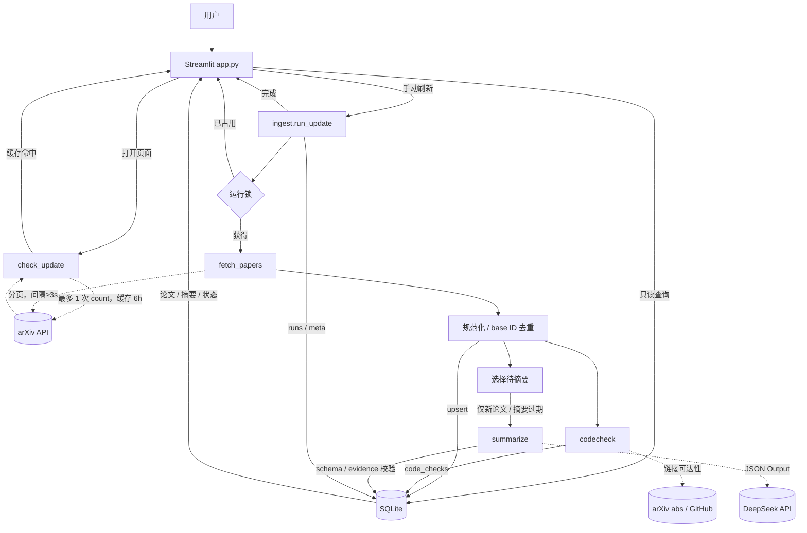

# 技术设计文档：PINN 论文自动追踪与中文摘要站

> 设计阶段 · v0.1 · 2026-10-31  
> 依据：`研究说明.md`、`AGENTS.md`  
> 本文只确定模块边界、数据传递和异常策略，不写实现代码。

## 1. 设计目标与原则

整个程序分成四个相对独立的业务部分：**获取（arXiv）→ 整理（DeepSeek + 代码线索）→ 保存（SQLite）→ 展示（Streamlit）**，另有一个轻量协调器负责把它们串起来。

核心原则：

- **页面只读数据库**：搜索、筛选、翻页和页面内 rerun 不调用 arXiv 或 DeepSeek；打开/刷新页面只做一次轻量更新检查（6 小时缓存）。
- **只有新内容才调用大模型**：同一论文的同一内容版本，摘要只生成一次。
- **所有外部 I/O 集中在管道里**：抓取、摘要、链接检查都由命令行管道执行；Streamlit 不承担长任务逻辑。
- **幂等、可恢复**：重复运行不重复入库；中途失败时，已完成的论文和摘要保留，下次继续。
- **不引入额外基础设施**：单机、单 SQLite 文件、单进程；不用队列、ORM、向量库、后台服务。

## 2. 总体架构



> 实线是本地控制流/数据流，虚线是外部请求。页面内的搜索、筛选、翻页只走 `APP → DB`；打开/刷新页面可能触发一次轻量 `check_update`（6h 缓存），但不会触发抓取或摘要。

## 3. 模块划分

### 3.1 四个业务部分与协调器

| 文件 | 角色 | 输入 | 输出 | 不负责 |
|---|---|---|---|---|
| `app.py` | Streamlit 页面：列表、搜索、筛选、详情、更新按钮 | 用户操作、DB 查询结果 | 页面 | 不直接写 SQL、不直接调用 arXiv/DeepSeek |
| `src/pinn_radar/ingest.py` | 数据入口与增量管道：抓取、规范化、去重、更新检查、编排 | 时间窗口、查询配置 | `PaperRaw` 列表、`UpdateStatus`、`RunResult` | 不做摘要推理、不写 SQL |
| `src/pinn_radar/summarize.py` | DeepSeek 结构化摘要：prompt、JSON 校验、证据校验、重试 | 单篇 `PaperRecord` | `SummaryResult` | 不访问 DB、不做代码状态判定 |
| `src/pinn_radar/codecheck.py` | 代码线索：正则抽取、链接检查、四态判定（**最终实现未单独建此文件，代码状态逻辑在 summarize.py 内**） | 单篇 `PaperRecord` | `CodeResult` | 不调用大模型、不生成摘要 |
| `src/pinn_radar/db.py` | SQLite：建表、upsert、摘要缓存查询、运行锁、UI 查询 | 模型对象、查询条件 | 行记录、统计 | 不访问网络、不调用模型 |
| `src/pinn_radar/queries.py` | 页面查询：统计、搜索、代码状态筛选、摘要 JSON 解析 | 筛选条件 | `PaperView` 列表 | 不访问网络、不写数据库 |
| `src/pinn_radar/models.py` | 边界数据对象 | — | dataclass / Pydantic 模型 | 不含 I/O 和业务逻辑 |
| `src/pinn_radar/config.py` | 路径、模型名、分页大小、并发数、超时 | 环境变量 | 配置对象 | 不含业务逻辑 |

依赖方向保持单向：

```text
app.py
  ├── src/pinn_radar/ingest.py
  │     ├── summarize.py
  │     └── db.py
  │           └── models.py / config.py
  └── src/pinn_radar/queries.py
        └── db.py
```

`ingest.py` 是唯一的编排者。它可以是 200–250 行；如果超过 300 行，再按 AGENTS 的变更控制拆出 `pipeline.py`，不要一开始就拆。

后端模块不 import Streamlit；只有 `app.py` 依赖 Streamlit，保证 CLI、测试和 P1 定时任务能复用同一套管道。最终实现采用 `src/` 布局：网页入口自动把 `src/` 加入 `sys.path`，命令行运行前设置 `PYTHONPATH=src`。

### 3.2 为什么不让 Streamlit 直接调 API

Streamlit 每次交互都会 rerun；如果抓取或摘要写在页面渲染路径里，一次筛选、一次翻页甚至一次浏览器刷新都可能重复调用 API。因此：

- 页面只查 SQLite；
- 更新按钮调用 `ingest.run_update()`，整个管道同步执行并显示进度；
- CLI `$env:PYTHONPATH="src"; python -m pinn_radar.ingest --days 30` 走同一个函数，方便调试和 P1 定时任务。

## 4. 数据传递过程

### 4.1 跨模块对象

| 步骤 | 对象 | 生产 → 消费 | 关键内容 |
|---|---|---|---|
| 1. 抓取 | `PaperRaw` 列表 | arXiv → `ingest` | arXiv ID、版本、题名、摘要、作者、分类、comment、日期、abs/pdf URL |
| 2. 入库 | `UpsertStats` | `ingest` → `db` → `ingest` | `new_ids`、`updated_ids`、`unchanged_ids` |
| 3. 选摘要候选 | `PaperRecord` 列表 | `db` → `ingest` | 论文元数据 + 现有摘要状态 + `source_hash` |
| 4. 摘要 | `SummaryResult` | `summarize` → `ingest` | 状态、中文摘要 JSON、原始机器 JSON、模型、prompt 版本、错误 |
| 5. 代码线索 | `CodeResult` | `codecheck` → `ingest` | 四态、链接列表、证据、检查时间 |
| 6. 保存 | 行记录 | `ingest` → `db` | 更新 `papers`、`summaries`、`code_checks`、`runs` |
| 7. 展示 | `PaperView` 列表 | `db` → `app` | 论文 + 中文摘要 + 代码状态，供列表/详情 |
| 8. 启动检查 | `UpdateStatus` | `ingest` → `app` | 是否需要更新、新论文数量、上次更新时间、错误 |

跨模块只传显式对象，不传裸 SQL 行或未整理的 dict；`PaperRaw` 与 `PaperRecord` 分开，避免把数据库状态混进抓取层。

### 4.2 一次手动更新的完整顺序

1. `app` 调用 `ingest.run_update(days)`；页面不自己判断锁，避免多标签页竞态。
2. `run_update` 用 `db.try_acquire_run_lock()` 原子获取运行锁；失败直接返回“已有更新任务”，不创建新的运行记录。锁记录 `locked_at`，超过 2 小时视为过期，下次运行前标记为 `interrupted`。
3. 获取成功后创建 `runs` 记录，状态 `running`。
4. `fetch_papers()` 按 UTC 时间窗分页抓取，规范化 ID、去重，返回 `PaperRaw` 列表。
5. `db.upsert_papers()` 写入/更新 `papers`，返回新增、更新、未变三组 ID。
6. 对新增/更新的论文执行 `codecheck`，写 `code_checks`；不需要调用大模型。
7. `db.get_summary_candidates()` 只选出：没有摘要、摘要失败且未超重试次数、`source_hash` 变化、内容未变但 prompt/model 需要显式重算的论文。
8. 对候选论文调用 `summarize`，并发 4–6；每篇成功后立即写 `summaries`，不攒到最后。
9. 更新 `runs` 统计；释放锁；`app` 重新查询并 `st.rerun()`。
10. 任何阶段失败：保留已完成的数据，`runs.status` 记为 `partial` 或 `failed`，页面显示可读错误。

## 5. 更新检查、页面刷新与 API 额度

时间窗口默认 30 天，用户可选 7/90 天或自定义；窗口只影响抓取范围，不影响摘要缓存复用。

### 5.1 打开网站时只做“检查”

`check_update(days)` 不抓论文、不调大模型，只判断“值不值得提醒用户”：

1. 读取 `meta.last_success_at`；没有记录 → 显示“首次使用，请更新数据”。
2. 如果 6 小时内刚成功更新过 → 直接显示“最近已更新”，不再请求。
3. 读取 `meta.update_check` 缓存；未过期（6 小时）且 `days`/`last_success_at` 未变，直接复用。
4. 否则发 **1 次** arXiv API 查询：用当前查询式 + `submittedDate:[max(last_success_at, 当前窗口起点) TO now]`，`max_results=1`、按提交日期倒序；读取 `opensearch:totalResults` 作为候选新增数 N，返回“可能有 N 篇新论文”。不比较单篇时间，也不抓正文。
5. 成功缓存 6 小时；失败缓存 30 分钟，并在页面显示“无法检查更新，可手动刷新”，不阻塞阅读。

检查结果只用于显示提示；**默认不自动启动管道**，避免打开页面就消耗额度、也避免长任务卡住 UI。

### 5.2 手动刷新

- 按钮位置：侧边栏“更新数据”，显示当前时间窗口和上次更新时间。
- 点击后同步执行 `run_update`，用 `st.status` 展示：抓取 → 入库 → 代码线索 → 摘要（x/y）→ 完成。
- 成功后清掉 `meta.update_check` 缓存，并更新 `last_success_at`。
- 按钮执行期间禁用；运行锁防止多标签页重复启动。
- 页面关闭或刷新导致中断：已完成的结果已落库，`runs` 记为 `interrupted`；下次运行从数据库状态继续。
- 没有新论文时不调用 DeepSeek，只显示“已是最新”。

### 5.3 搜索、筛选、翻页和页面内 rerun

这些操作只查 SQLite，**不抓取论文，也不调用 DeepSeek**。搜索用 `LIKE`，论文量在千级以内足够，不需要全文索引或向量库。浏览器重新打开/刷新页面会走一次 5.1 的轻量检查，但仍不会启动抓取或摘要管道。

### 5.4 API 调用预算

| 动作 | arXiv API | DeepSeek |
|---|---|---|
| 打开/刷新页面 | 最多 1 次轻量 count（6h 缓存） | 0 |
| 搜索、筛选、翻页 | 0 | 0 |
| 手动刷新，无新论文 | 1–2 次分页 | 0 |
| 手动刷新，N 篇新论文 | 1–2 次分页 | N 次（失败重试另计） |
| 同一天再次刷新 | 1–2 次分页 | 0（已有摘要直接复用） |
| 修改 prompt/model | 0 | 不自动调用；显式 `--resummarize-stale` |
| 6 小时内反复刷新页面 | 最多 1 次轻量 count | 0 |

粗估：30 天约 200 篇，arXiv 分页 2 次左右；DeepSeek 约 200 次调用，按 flash 峰时价约 $0.2，4–6 并发约 5–8 分钟。90 天约 600 篇，费用和时间约 3 倍；选择 90 天时在按钮旁提示预计时间/费用，但不自动截断结果。

## 6. 去重、摘要复用与重新调用规则

### 6.1 论文去重

- 从 API 的 `<id>` 取出 base ID：去掉末尾 `v1`、`v2`，例如 `2610.12345v2 → 2610.12345`。
- `papers.arxiv_id` 设为唯一主键；同一篇论文只保留一行。
- 抓取过程中先用内存 dict 按 base ID 去重，再交给 `db.upsert_papers()`；跨页、跨窗口重复由数据库唯一约束兜底。
- 同一 ID 的新版本：更新 `version`、`updated_at`、元数据，不新增行；`first_seen_at` 保留首次时间。
- 窗口滑动导致旧论文再次出现：`unchanged_ids` 直接跳过，不重新摘要。
- 不删除不在当前窗口的旧论文；页面按日期范围筛选。

### 6.2 摘要复用条件

摘要缓存以数据库为准，不依赖 Streamlit 内存缓存。命中以下条件直接复用，不再调用 DeepSeek：

1. `summaries.status = success`；
2. `summaries.source_hash = papers.source_hash`；
3. `summaries.prompt_version` 与当前 prompt 版本一致；
4. `summaries.model` 与当前模型一致。

`source_hash = sha256(规范化后的 title + 摘要)`。comment 变化只影响代码线索，不触发摘要重算。`version` 只用于记录和请求追踪；即使版本号从 v1 变成 v2，只要摘要内容哈希没变，就跳过。

只有确实需要发起请求时，才把 `arxiv_id + version + source_hash + prompt_version + model` 写进 `raw_json` 和运行日志，便于追溯。

### 6.3 哪些情况重新调用大模型

| 变化 | 重新抓取 | 重新摘要 | 重新检查代码线索 |
|---|---|---|---|
| 新论文 | 是 | 是，一次 | 是 |
| 同 ID、同内容、同版本 | 是（窗口重叠） | 否 | 否 |
| 版本升级，但 title/abstract 未变 | 是 | 否 | comment 变了才重查 |
| title 或 abstract 变化 | 是 | 是 | 是 |
| 仅 comment 变化 | 是 | 否 | 是 |
| 作者/分类变化 | 是 | 否 | 否 |
| 摘要失败且 attempts < 2 | 下次运行时重试 | 是 | 否 |
| 摘要失败且 attempts ≥ 2 | 否 | 仅手动 `--retry-failed` | 否 |
| prompt 或 model 变化 | 否 | 不自动；显式 `--resummarize-stale`，先预览数量/费用 | 否 |
| 人工编辑过摘要 | 否 | 不自动覆盖；仅显式 `--regenerate` | 否 |
| 页面刷新/筛选 | 否 | 否 | 否 |

失败次数记在 `summaries.attempts`，避免每次页面刷新或每次更新都无限重试。失败摘要必须在页面显示为“摘要失败”，不能伪装成成功；A3 抽检是否包含失败项，需在验收前明确口径。

## 7. 数据模型与保存字段

所有时间存 UTC ISO 8601，页面显示时转换为 `Asia/Shanghai`。

### 7.1 `papers`

| 字段 | 说明 |
|---|---|
| `arxiv_id` | base ID，主键 |
| `version` | 版本号，整数 |
| `is_fixture` | 测试数据标记，生产查询过滤 0 |
| `title` / `abstract` | 英文原文，原样保存 |
| `authors_json` / `categories_json` | JSON 数组 |
| `primary_category` | 主分类 |
| `published_at` / `updated_at` | arXiv 时间 |
| `comment` / `journal_ref` / `doi` | API 有则保存，没有为空 |
| `abs_url` / `pdf_url` | 原文链接；PDF 缺失允许为空 |
| `link_status` / `link_checked_at` | `ok` / `unverified` 及检查时间；`unverified` 仍入库并计入 A1 检索数量，默认列表只展示 `ok` |
| `source_hash` | title + abstract 的内容哈希 |
| `source_query` / `fetched_at` / `first_seen_at` | 来源与时间追溯 |

### 7.2 `summaries`

| 字段 | 说明 |
|---|---|
| `arxiv_id` | 主键，外键到 papers |
| `status` | `success` / `failed` |
| `summary_json` | 当前中文摘要（可被人工修正） |
| `raw_json` | 机器原始输出，保留不覆盖 |
| `search_text` | 中文摘要拼接，供 LIKE 搜索 |
| `model` / `prompt_version` | 调用配置 |
| `source_hash` | 生成时对应的内容哈希 |
| `attempts` / `error` | 重试次数与最后一次错误 |
| `generated_at` / `edited_by` / `edited_at` | 生成/人工编辑追溯 |

`summaries` 中没有记录表示“待摘要”；`status` 只记录成功或失败，不把失败伪装成空摘要。

`summary_json` 结构：

```json
{
  "one_liner": {"zh": "...", "evidence_en": "..."},
  "contributions": [{"zh": "...", "evidence_en": "..."}],
  "methods": [{"zh": "...", "en": "...", "evidence_en": "..."}],
  "datasets": [{"zh": "...", "en": "...", "evidence_en": "..."}],
  "project_relevance": {"zh": "推断：...", "basis": "..."},
  "limitations": {"zh": "...", "evidence_en": "..."}
}
```

- `methods` / `datasets` 没有就返回空数组，页面显示“摘要未提及”，不补默认值。
- 事实性字段的 `evidence_en` 必须是英文原文子串；校验失败重试，仍失败则 `summary_failed`。
- `project_relevance` 允许推断，但必须带“推断：”和依据，不伪造英文引文。

### 7.3 `code_checks`

| 字段 | 说明 |
|---|---|
| `arxiv_id` | 主键，外键到 papers |
| `status` | `verified` / `claimed` / `not_found` / `manual`（UI 显示已确认/仅有声明/未发现/人工修正） |
| `links_json` | 候选链接数组：`url`、`source`、`kind`（code/dataset/project/other）、`http_status` |
| `evidence_text` | 原文中的开源声明/链接上下文 |
| `checked_at` / `note` | 检查时间与人工说明 |

### 7.4 `runs` 与 `meta`

`runs`：`run_id`、`started_at`、`finished_at`、`days`、`window_start/end`、`query_hash`、`fetched/new/updated` 计数、`summary_ok/summary_failed`、`code_checked`、`llm_calls`、`input_tokens`、`output_tokens`、`cost_estimate`、`status`、`error_stage/error_message`。

`meta`：键值表，保存 `schema_version`、`last_success_at`、`last_run_id`、`active_run_id`、`update_check` 缓存。

## 8. 异常处理

| 场景 | 处理 | 数据/页面状态 |
|---|---|---|
| arXiv 429/5xx/超时 | 指数退避重试最多 3 次；仍失败则中止本次运行 | 保留旧数据；`runs=failed`；提示稍后重试 |
| 单条 XML 解析失败 | 跳过该条并计数；整页不可解析则中止 | 其余页面已入库；`runs=partial` |
| 时间窗口无结果 | 正常结束，不调用 DeepSeek | `runs=success`；页面“暂无新论文” |
| `abs_url` 校验失败 | 重试 1 次；仍失败标 `link_unverified` | 保留库中，默认列表不展示；单独筛选 |
| 代码链接 404/超时 | 按“仅有声明/未发现”处理，记录状态 | 不阻塞整批摘要 |
| codecheck 单篇异常 | 记录 `note`/待核实，继续下一篇 | 不阻塞摘要；下次更新重查 |
| DeepSeek 401/403 | 立即停止摘要阶段 | 论文和已生成摘要保留；`runs=partial`；提示检查 key |
| DeepSeek 429/5xx/超时 | 单篇重试最多 2 次；连续 5 篇失败则停止摘要阶段 | 已成功的保留；失败项标 `summary_failed` |
| JSON 非法/证据不匹配 | 重试最多 2 次；仍失败标 `summary_failed` | 页面显示失败徽标，不展示假摘要 |
| 余额不足/配额耗尽 | 停止摘要阶段，保留已生成结果 | `runs=partial`；提示充值/换 key |
| 未配置 key | 页面进入只读模式 | 更新按钮禁用；种子库仍可浏览 |
| 运行锁已存在 | 不启动第二个任务 | 页面提示“已有更新任务” |
| SQLite 错误/文件损坏 | 中止并报错，不自动删除或重建 | 提示备份路径；不静默吞错 |
| 页面关闭/刷新中断 | 已完成记录保留；超时未完成的 run 标 `interrupted` | 下次运行按数据库状态继续 |
| 调用成功但写库前崩溃 | 下次可能重复调用一次 | 已知边界；结果以最后一次成功写入为准 |

## 9. 复杂度评估与精简建议

### 9.1 结论

**当前设计不算过度设计。** 四个业务部分对应四个真实职责，`ingest.py` 只是协调器；SQLite、单进程、无队列、无 ORM，都是为这个规模服务的。真正增加复杂度的是“并发摘要 + 运行锁 + 失败恢复”，但这是满足 200 篇/10 分钟和防止重复扣费所必需的。

### 9.2 可以砍掉或延后的

- **打开页面自动更新**：只做检查 + 手动按钮；自动更新会引入后台任务、重复触发和额度不可控，P1 用系统任务计划更简单。
- **独立 update_check 模块**：放在 `ingest.py` 内约 40 行即可，不单独建服务。
- **摘要历史表**：P0 只保留当前 `summary_json` + 机器 `raw_json`；版本历史 P1。
- **多页 Streamlit / 自定义前端**：单页足够，搜索筛选用侧边栏。
- **FTS5 / 向量检索**：千级论文用 `LIKE` 足够。
- **PDF 全文、多数据源、逐篇全网搜代码**：研究说明已列为不做。
- **应用内定时器 / 后台 worker**：P1 用 Windows 任务计划调用 CLI。
- **人工编辑 UI**：P0 可只预留字段和 CLI；编辑界面 P1。

### 9.3 不建议再加的

- ORM、Repository/Service 分层、DTO 映射；
- Redis/Celery/消息队列；
- FastAPI/React 双端；
- 为每个模块建独立包或微服务；
- 为“以后可能扩展”提前抽象模型适配器、数据源适配器。

### 9.4 建议的最小文件集

```text
app.py
src/pinn_radar/
  config.py
  models.py
  ingest.py
  summarize.py
  db.py
  queries.py
prompts/
  summarize_v1.md
scripts/
  reliability_check.py
tests/
```

共 7 个代码文件（含 `app.py`）。`models.py` 只放 dataclass/Pydantic，不写逻辑；独立的 `codecheck.py` 最终未拆出，代码状态逻辑在 `summarize.py` 内。`ingest.py`/`db.py` 已超过 300 行建议值，是已知技术债，后续再按 AGENTS §6 拆分。

## 10. 实施顺序与验收对应

1. **D1–2**：`db.py` + `ingest.fetch_papers`，用 7 天窗口真实抓取 10 篇，验证去重、字段、链接校验。
2. **D3–4**：`summarize.py` + `summaries` 表，验证 JSON/证据校验、缓存复用、失败重试。
3. **D5**：`codecheck.py` + `app.py` 列表/搜索/筛选/详情。
4. **D6**：`check_update`、运行锁、手动刷新、30 天约 200 篇实测。
5. **D7**：错误处理、种子库、README、A1–A7 验收记录。

| 验收 | 设计支撑 |
|---|---|
| A1 检索与去重 | base ID 唯一键、分页拉全、upsert 统计 |
| A2 200 篇/10 分钟 | arXiv 分页 3 秒间隔；DeepSeek 4–6 并发；链接校验 2 分钟预算 |
| A3 摘要质量 | JSON schema + 每条 evidence 子串校验 + 失败可见 |
| A4 开源状态 | 程序四态 + 链接检查 + 来源/时间 |
| A5 页面 | 单页 DB 查询 + 组合筛选 + 详情链接 |
| A6 可复现 | 种子库、README、测试 fixture |
| A7 成本 | `runs` 记录 token/费用；30 天目标 <$1 |

## 11. 需要你确认的默认选择

1. **启动检查**：采用“最多 1 次 arXiv count，缓存 6 小时”，而不是完全离线只看时间戳；后者更省请求，但无法知道是否真有新论文。
2. **手动刷新**：P0 同步执行 + 运行锁，不引入后台进程；刷新页面不会重复调用，关闭页面可能中断，下一次继续。
3. **摘要证据**：每个事实性条目单独带 `evidence_en`，比全篇一个证据数组稍复杂，但能直接防止编造方法和数据集。
4. **prompt/model 变化**：不自动批量重跑；只提供显式 `--resummarize-stale`，先显示数量和预估费用。
